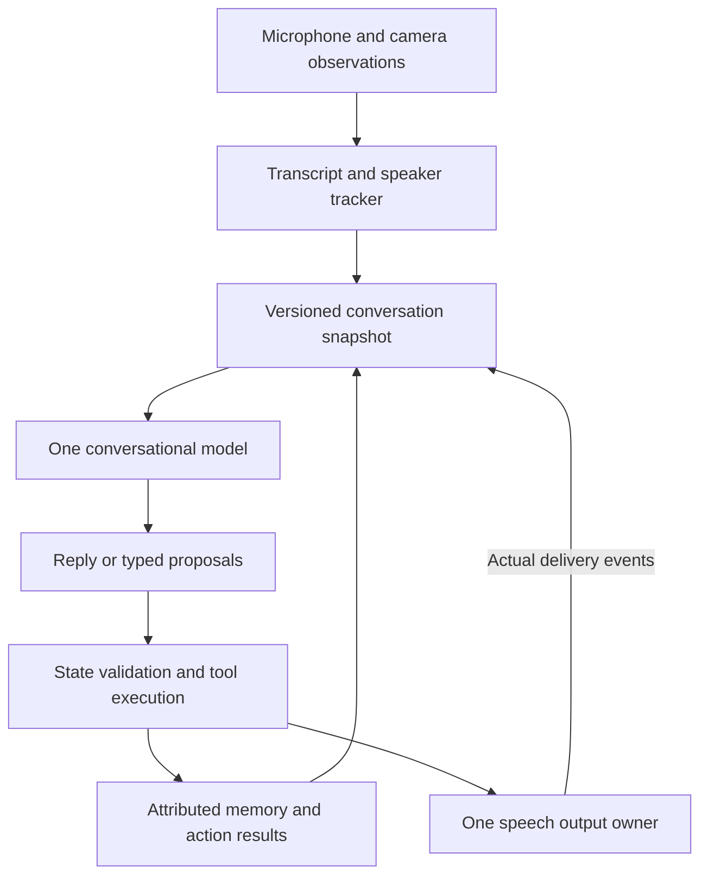

# Conversation core design

Status: the core responsibilities through slices 0–4 are implemented. See the
[implementation evidence](docs/INITIAL_TEST_PROGRAM.md#core-implementation-evidence-slices-2-4)
and [operations guide](docs/CORE_OPERATIONS.md). Live microphone/speaker/camera and
held-out group acceptance remain open. Requirements, proposed future work, and
unmeasured thresholds are distinguished below; the full robot is outside this build.

## Decision status

| Status | Decision |
| --- | --- |
| User requirement | Start independently in the new v3 repository and preserve knowledge from v2. |
| User requirement | Learn voices through ordinary conversation and association; retain accepted original audio for later model migration. |
| User requirement | Never use mouth-motion detection for speaker identity or enrollment. |
| User requirement | Support one-to-three visible people, including a dev Mac with no directional audio. |
| User requirement | Use microphone direction as supporting evidence and camera left/center/right as coarse context, not exact camera-to-microphone bearings. |
| User requirement | The torso microphone can drift roughly 15–20 degrees with the hero-arm servo; center and hold that servo during enrollment on the robot. |
| Working design | One conversational decision owner, one acoustic tracker, one state owner, one output owner, and minimal attributed memory. |
| Working design | Python and a single process for the first program; existing model integrations are starting candidates. Swift remains an option if a measured need or native-app goal justifies it. |
| Working design | Batch ASR with a 1.2-second pause allowance. Resumed non-echo speech yields an unheard reply and preserves source history for the continuation. The conversation owner can wait silently on unfinished thoughts. Human barge-in during speaker echo remains unsupported. This replaces finish-pending-first after the September 10 live test demonstrated repeated interruptions. |
| Working design | Session history keeps up to 32 source-preserving exchanges with a 24,000-character request-history budget. Eviction removes whole exchanges; no automatic summary or durable fact extraction is added. |
| Working design | Ordinary replies use one primary model generation with low reasoning; optional tool-result follow-ups are visible and bounded. The September 10 multi-turn repair measured improved listening/participation decisions without a separate classifier. |
| Open experiment | Speaker segmentation/diarization implementation, calibrated thresholds, confidence categories, and useful audio durations under real room conditions. |
| Open experiment | Exact latency/coverage release thresholds, camera workload, offline profile, and when native audio code would provide a measurable benefit. |

Changes to working choices should be recorded with the problem, evidence, decision,
and retired behavior. An unanswered design question does not justify implementing
several permanent alternatives.

## Principles

1. Preserve observations before interpreting them. Keep exact text and evidence
   timestamps; never replace uncertainty with a convenient participant name.
2. Let the conversational model interpret language. Pending questions, introductions,
   jokes, corrections, and changes of subject belong to that interpretation.
3. Code validates and executes. Physical safety, evidence freshness, audio quality,
   storage integrity, identity/write permissions, and actual action outcomes remain
   deterministic responsibilities.
4. A name mention, visible face, likely speaker, and intended addressee are separate
   objects. Agreement can support an association; none is interchangeable with another.
5. One owner changes each kind of state. Providers publish observations or results;
   they do not independently speak, enroll people, or write personal facts.
6. Uncertainty permits ordinary conversation without granting learning permission.
   Clarify when identity materially affects an action or memory, not on every weak turn.
7. Every durable claim and voice sample has provenance and a correction/deletion path.
8. Keep the default path small. Load only selected capabilities and measure optional
   work under the actual listening and speaking workload.
9. Completing a replacement includes removing its predecessor and unused settings.
10. Evaluate behavior on held-out real conversations as well as deterministic checks.

## Ownership and boundaries

| Owner | Owns | Must not do |
| --- | --- | --- |
| Capture/perception adapters | PCM, timestamps, transcript quality, face tracks, current direction observations | Guess names from text, write profiles, speak, or load unrelated models |
| Speaker tracker | Session voice tracks, change/overlap evidence, identity candidates, acoustic eligibility for learning | Interpret pronouns, turn a mentioned name into the speaker, or trust mouth telemetry |
| Conversation model | Meaning, referenced people, addressee interpretation, replies, clarification, proposed tools/claims | Certify a voice from a cosine number or claim unexecuted actions succeeded |
| State owner | Participant associations, pending exchanges, claim transitions, validated action requests | Reinterpret free speech through a competing regex/handler ladder |
| Executors/store | Validated tool execution, transactional persistence, correlated results | Choose an independent conversational reply or silently retry obsolete actions |
| Output owner | Speech generation, scheduling, cancellation, delivery events | Treat generated or queued text as already heard by the user |

These are responsibilities and interfaces, not six services. Start with one process,
typed records, bounded queues, and dependency injection. No broker or distributed
framework is needed. Blocking providers may have workers; they submit results to
the owner rather than mutating shared conversational globals.

The diagram describes authority, not a requirement to buffer every reply until all
text exists. Ordinary prose streams to output. Acknowledgments dependent on writes
or actions wait for their results, as described below.

## Turn lifecycle

1. Capture PCM with monotonic start/end times and a session/capture ID. Publish face
   presence and optional direction for that same interval. No current observation
   means missing evidence, not permission to reuse a stale bearing.
2. Apply echo/self-noise and transcript-quality gates. Batch ASR and speaker analysis
   may overlap where the backend permits it. Avoid duplicate embedding work.
3. Resolve acoustic track candidates and mixed-speech status. A split requires
   supported timing; assigning one transcript to multiple people is not diarization.
4. Build a compact snapshot: verbatim recent turns, candidate participants, pending
   delivered questions, current activity, relevant claims with provenance, and
   action/delivery results. Include session ID, turn ID, and state revision.
5. The main model responds or requests a typed operation. An unanswered name/job
   question is context, never a rule that consumes the next utterance as its answer.
6. The state owner validates targets, evidence references, revision, permissions,
   and operation schema. Unsupported or stale proposals produce explicit results.
7. Execute accepted operations and publish their outcome. Queue speech through the
   output owner. Record what began, completed, was interrupted, or failed.
8. Later input is processed in capture order. A stale result cannot change a new
   session, reopen a settled question, or revive cancelled playback.

A narrow stop/cancel fast path can act immediately. Normal language interpretation
does not acquire another Python semantic layer simply because a tool is available.

## Model/tool contract

Use one main generation for ordinary replies. Do not put a serial classifier or a
mandatory JSON plan before every sentence. Initial operations are a small capability
set, not a general agent framework:

- Resolve an explicitly extracted person reference against supplied candidates or
  the store; exact unique names/aliases/nicknames are deterministic lookups.
- Propose a self-introduction or an association concerning another visible person.
- Propose, recall, correct, or retract a small attributed claim.
- Request one clarification when needed, or continue without naming the speaker.

These are semantic operations to design into tools; the names above are not existing
APIs. Common reads can be included in the snapshot to avoid unnecessary round trips.
Executors return `request_id`, target, outcome, reason, and state revision. Writes
are idempotent by request ID. A retry must not create a second person or claim.

If a turn requires a mutation, validate it before speaking an acknowledgment of that
mutation. A tool-only turn may need a follow-up generation using its result. Count
and time that call separately; do not claim every tool turn is one-call. The initial
design permits one bounded result continuation rather than an open-ended retry loop.
Ordinary prose can stream immediately when it makes no unexecuted success claims.

Do not regex-parse generated prose back into actions or stored facts. Raw transcripts,
retrieved claims, model summaries, and source documents are data, not tool authority.
Models receive allowed operations and candidate IDs; fabricated IDs fail validation.

## Speaker tracking and identity

### Separate the questions

Maintain distinct identifiers for audio captures, session speaker tracks, persistent
people, camera tracks, and the turn's addressee. A person's name is a display label
and lookup value. Track identity and person identity can remain unresolved separately.

Example: Bret says "That's Jeff Benziger." The audio may belong to Bret or an
unresolved track. The model identifies Jeff as the referenced person. A unique
nickname-plus-surname lookup can resolve Jeffrey's existing person record, but this
does not bind Bret's audio to Jeffrey or authorize saving a small uncertain face.

### One tracker for named and unnamed voices

Compare each usable segment with both recent session tracks and enrolled profiles.
Retain plausible alternatives instead of forcing the highest enrolled score to win.
An unknown-person option is always available. Brief/poor audio need not mint a new
track, flip an established identity, or refresh an embedding.

The tracker must detect or abstain on speaker changes and overlap. CAM++ supplies
embeddings; its identification threshold is not automatically a speaker-change
threshold. V2's early CAM++ integration confused those tasks. Evaluate dedicated
segmentation plus incremental clustering against a simpler bounded baseline before
adding another resident model. See the research links in V2_REFERENCE.md.

Use several compatible samples and their quality/history, not only one best score
or a growing unconditional average. Update track representations only from accepted
evidence. Recency alone must not let one person inherit the previous person's turn.
Keep uncertain captures available for review without contaminating either profile.

### Evidence states and permissions

| Evidence state | Conversation | Persistent association/learning |
| --- | --- | --- |
| Unresolved or mixed | Respond without a name; ask a targeted clarification only when needed | Retain source turn; no named voice sample or attributed self-report |
| Plausible contextual association | Continue an exchange with uncertainty available to the model | Hypothesis only; cannot refresh a voice or silently promote personal facts |
| Supported acoustic association plus trusted interpretation | Named interaction where appropriate | Eligible for validated claims; voice enrollment still requires its sample chain |

These are policy categories, not calibrated probabilities. Cosine similarity is
not a confidence percentage. Calibrate acceptance, rejection, and ambiguity using
same-person and different-person recordings from this hardware. Measure false
assignments, abstention, and track fragmentation together.

The car-session implementation now distinguishes tentative track continuity from
strong reference updates and verified profile matches. A tentative track carries
no person identity and cannot authorize self attribution or enrollment. Playback
gate transitions form capture boundaries; simultaneous playback/human audio remains
excluded. Abrupt changes supported by compatible windows on both sides can propose
approximate within-capture splits. Derived turns retain source offsets and cannot
write personal facts or enroll voices while these boundaries remain unvalidated.

No identity confidence can come from lip/jaw/mouth motion, including old derived
"active speaker" fields. A known face establishes visibility; a small face may
itself have uncertain identity. A single face does not prove no one is off camera.

### Natural enrollment and safe growth

An explicit self-introduction, or a known face's speaking confirmation interpreted
in context, can anchor a provisional association. Accumulate clean acoustic groups
before names are known, including alternating speakers. Attach an introduction to
the existing matching group; earlier compatible samples count toward enrollment.
Accepted samples must agree with the name anchor and one another, and must lack
competing speaker or direction evidence. Reply suppression or interruption does
not discard input evidence. Unverified groups persist separately from accepted
profiles across restarts; explicit identity corrections can retract them.

V2 starts with three qualifying turns, two voiced seconds per sample, and eight
voiced seconds total. These are useful baseline parameters, not a proven optimum
or a promise that every person is learned in three turns. Short name/yes replies
can be provisional anchors without qualifying as training samples.

Do not enroll from Rex's playback, impersonations, echo, overlapping speech, robot
movement, or doubtful transcripts. Another person answering "that's Jeff" cannot
confirm Jeff's voice. A correction or decline cancels an affected provisional chain.
No single confirmed name statement proves a legal identity or prevents deliberate
false self-identification; keep the claimed name and acoustic association distinct.

For a recognized face without a voice profile, a natural prompt might be: "Jeff,
is that you speaking? I need to recalibrate my audio receptors." With several small
faces: "I think that's Bret on my left—is that right?" Treat another person's answer
as a reference to the visible person, not that person's voice confirmation. If the
evidence cannot tell who answered, retain the hypothesis and continue or clarify;
the expected answerer alone is not proof. These are dialogue examples, not scripts.

When Rex has just greeted Bret and hears a plausible reply, carry the recent exchange
into the model's context. It can reply naturally without repeating a broad name
question. That conversational continuity does not authorize adding the audio to Bret's
profile. Ask a targeted identity question only when the uncertainty matters.

Accepted original audio and model-specific embeddings commit together. Preserve
sample rate, timestamps, transcript, quality, available direction, source device,
acceptance evidence, and model/preprocessing version. Deduplicate audio/prints.
Model migration uses original recordings; it never relabels old vectors as a new
model. Bounded profile growth uses this same owner, not a passive second writer.

### Microphone geometry

On the dev Mac, direction is unavailable. Do not invent a central bearing because
the user is usually in front of the laptop. Support real two-person testing there.

On the robot, the torso microphone moves with the hero-arm servo. Before enrollment,
acquire a bounded hold, move to the midpoint of its configured safe range, wait for
settling, and exclude transition audio. Release on completion, cancellation, expiry,
manual takeover, motion, sleep, shutdown, and errors. Other servo writers must honor
the hold. Base/microphone movement invalidates the old direction reference.

Use camera left/center/right to phrase a clarification about a visible track. A
confirmed utterance establishes an acoustic bearing for that person. Camera/head
orientation is not an exact microphone coordinate transform. Speakers may be only
10–30 degrees apart; a wide fixed tolerance cannot establish their separation.
Evaluate measured direction spread and competing tracks. Preserve ambiguity when
direction and voice cannot distinguish them. No direction requirement on the Mac.

## Minimal memory

The first program must exercise hear, interpret, attribute, save, restart, recall,
and correct. A pleasant chat using only its current transcript is insufficient.

Start with a few logical records in a v3 SQLite database; schema names are proposals:

| Record | Essential content |
| --- | --- |
| Person | Stable ID, display name, explicit aliases/nickname, source/import mapping |
| Source turn | Exact text, capture/turn/session IDs, time, track candidates, attribution and transcript-quality evidence |
| Association | Track/person or face/person hypothesis, supporting turns, status, revision; session tracks expire |
| Claim | Subject, predicate/value, said-by identity or unresolved track, source turn, direct/third-party status, candidate/accepted/retracted/superseded state |
| Voice sample | Original audio, digest, acceptance metadata, embedding namespace, person association |
| Event/result | Proposed operation, validation result, write/result ID, question delivery/settlement, playback outcome, correction history |

An accepted self-report means the identified person said it, not that its truth was
externally verified. A third-party claim stays attributed to its source. Unknown
speaker claims can remain pending with their explicit subject; they do not become
someone's established self-report. Pronouns or ambiguous names require context or
clarification before a subject-specific write.

The conversational model proposes meaning. The state owner checks source references,
speaker eligibility, subject resolution, conflicting claims, operation shape, and
revision. It cannot prove semantic correctness from a schema, so preserve the quote
and audit decision and evaluate real failures. Important uncertainty prompts a
clarification; routine clear claims need not turn into a repeated confirmation form.

Corrections supersede or retract earlier claims; ordinary recall uses the current
accepted view. Do not silently rewrite the original transcript. Queries must not
present an old claim without its correction, or a report from Bret as Jeff's own
statement. Personal facts, generated jokes, and raw conversational questions remain
different record types; generated impersonation text is not biographical evidence.

Use parameterized transactions with one write owner and idempotent operations.
Keep memory lookup small and deterministic initially. Semantic embeddings, large
summaries, relationship scoring, and autonomous memory-driven commentary are deferred.
Forgetting includes dependent recordings, derived references, and pending proposals;
the active store and retrieval must stop exposing deleted personal information.

## Conversation and output behavior

The model receives recent verbatim turns plus a compact state snapshot. Summaries
are advisory, source-bounded, and versioned; they do not overrule a correction or
become facts by being included in the prompt. Snapshot builders must not perform
unbounded synchronous model calls or expensive per-candidate embeddings.

A question becomes pending only when delivered. Its intended addressee, actual
delivery, answer, interruption, expiry, and correction are explicit state. A new
request can supersede it. No onboarding mini-program owns future speech by default.

Give Rex his existing character through a reviewed persona prompt and examples.
Do not restore serial mood/comedy/governor layers that reinterpret the model's
answer. Features propose context or tools; they cannot force a separate response.

Participation is decided by this same model call. `remain_silent` is an explicit
per-turn tool result, with no TTS and no result-continuation generation. The completed
tool exchange is retained in history without fabricated spoken text. Silence does
not persist as a mute mode; subsequent addressed speech is evaluated anew.

Assign speech a generation ID and track requested/generated/queued/started/completed/
interrupted/failed states. Keep generated transcript text distinct from what was
actually played. A cancellation invalidates queued tails and late callbacks. Bounded
queues provide backpressure; overflow or dropped input is logged, never silent.

Online ElevenLabs is the first TTS candidate. Preserve its tested request and playback
details through an adapter. Local Breeze and impersonations are later capabilities:
ordinary Breeze speech uses the established 1.5-second preroll when introduced;
the current v2 impression path prepares a complete take. Neither behavior should
be replaced by old abort-on-underrun logic. Verify output content and live playback
separately under load before claiming a speech regression fixed.

## Configuration, model lifecycle, and platform

Use one validated settings schema and a small declarative capability profile.
Secrets and local device selection remain local. Only real user choices and
calibrated thresholds become settings; every setting has one documented consumer.
Do not transplant v2 configuration or preserve every earlier backend choice.

For each enabled capability, declare provider, model/version, required resources,
startup policy, optionality, and close behavior. Print an effective startup report:
what loaded, why, whether it is ready, and what failed. Disabled capabilities load
no models or devices. Fallbacks must be explicit and reported, not silent changes
to voice, identity namespace, transcript quality, or network behavior.

The initial Python candidate minimizes integration changes. MLX/ONNX already run
native model computation. Swift may benefit native audio/UI or deployment, but no
whole-program speedup is established. Do not change architecture, every model, and
language simultaneously. Keep adapter boundaries suitable for a later measured port.

Use a new dependency environment and lock the dependencies actually required by the
tested adapters. No blanket v2 requirements copy. A shared MLX scheduling policy is
needed when multiple local models are enabled; avoid overlapping work merely because
it runs in separate Python threads. CPU threads and optional camera work also have
budgets. Test on the M2/16 GB target as well as the development laptop.

## Observability and evolution

Every turn should make these inspectable: what was heard, candidates and conflicts,
why attribution was accepted or withheld, the snapshot revision, tools/claims
proposed, writes accepted/rejected, and what actually played. Keep diagnostics out
of spoken replies unless they help the user resolve a real problem.

Measure end-of-speech, capture endpoint, transcript ready, speaker evidence ready,
model request/first output, audio ready, playback start/end, and total completion.
Separate provider time from queueing and resource contention; missing metrics are
unknown. Release criteria and evaluation cohorts live in the initial test program.

Add later features through a typed request/result interface. Motor/servo executors
retain deterministic limits and emergency stop; they do not acquire conversational
authority. Bring over integrations one at a time, update reference evidence, and
retire replaced code and configuration. Git preserves history; runtime fallbacks
must not preserve an obsolete second brain indefinitely.

## Face attribution and shared vision

The robot design target is a base Apple M2 with 16 GB unified memory. The
[face attribution plan](docs/FACE_ATTRIBUTION_PLAN.md) defines automatic contextual
face/name association, third-party introductions, stable temporal evidence, and
a shared bounded camera pipeline for future pose/object consumers. Its budgets
remain proposed measurement gates. The dev-Mac core now implements the shared
latest-frame camera path, SCRFD-10G/EdgeFace-S recognition, contextual name association,
quality-gated persistent face references, targeted questions, corrections and deletion.
A recognized face remains separate from the acoustic speaker. Robot direction,
movement, camera calibration and whole-core M2 acceptance are still outstanding.
